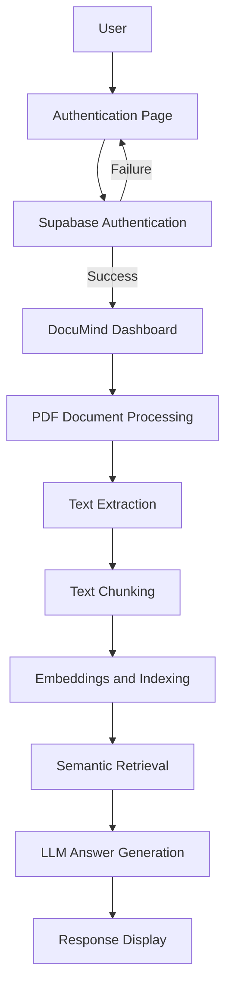

# 📚 DocuMind — Chat with Your Documents

**Your documents. Your questions. Intelligent answers.**

DocuMind is an AI-powered document intelligence application that enables users to interact with documents using natural language. Instead of manually searching through lengthy PDFs, users can ask questions and retrieve relevant information through an AI-powered question-answering workflow.

By combining Retrieval-Augmented Generation (RAG), semantic retrieval, and Large Language Models (LLMs), DocuMind aims to make document analysis more accessible, efficient, and intuitive.

---

## ✨ Features

- 🔐 **User Authentication** — End-to-end sign-up and login powered by Supabase Authentication.
- 👤 **Authenticated User Access** — Authentication flow integrated with the DocuMind application.
- 📄 **PDF Document Processing** — Extract text from PDF documents for further analysis.
- 💬 **Natural Language Q&A** — Ask questions about document content in everyday language.
- 🔎 **Semantic Retrieval** — Retrieve relevant document passages based on query meaning.
- 🧠 **LLM-Powered Responses** — Generate answers using retrieved document context.
- 🎨 **Interactive User Interface** — A user-friendly web interface for interacting with the application.
- 🖥️ **Local LLM Support** — Integration with locally hosted language models through Ollama, where configured.

---

## 🏗️ System Architecture

DocuMind follows a Retrieval-Augmented Generation (RAG) workflow to connect user queries with relevant document information.



### How It Works

1. **Authentication:** Users sign up or log in through Supabase Authentication.
2. **Document ingestion:** PDF documents are processed to extract their text.
3. **Text chunking:** Extracted text is divided into smaller passages for retrieval.
4. **Embedding generation:** Text chunks are converted into vector representations.
5. **Indexing:** Document representations are stored in the configured search index or vector store.
6. **Query processing:** Users ask questions in natural language.
7. **Semantic retrieval:** The system retrieves passages relevant to the user's question.
8. **Answer generation:** The retrieved context is supplied to an LLM to generate a response.
9. **Response display:** The generated answer is presented through the application interface.

*The architecture diagram represents the intended RAG workflow; individual components should match the implementation in the current codebase.*

---

## 🔐 Authentication

DocuMind uses **Supabase Authentication** to provide a functional user registration and login experience.

### Authentication Capabilities

- User sign-up and login.
- Supabase-powered identity and authentication management.
- Integration of the authentication flow with the DocuMind application.
- Access to the application following successful authentication.

Authentication is implemented through Supabase rather than a frontend-only login interface.

---

## 🛠️ Technology Stack

| Component | Technology |
|---|---|
| Frontend | React, Vite (if used in the current implementation) |
| Authentication | Supabase Authentication |
| Backend | Python |
| AI Architecture | Retrieval-Augmented Generation (RAG) |
| Language Model | Ollama / configured LLM |
| Document Input | PDF |
| Version Control | Git and GitHub |

*The exact embedding model, vector store, backend framework, and supporting libraries depend on the current implementation.*

---

## 🚀 Getting Started

Follow these steps to set up DocuMind locally.

### Prerequisites

- Python
- Node.js and npm, if using the React/Vite frontend
- Git
- An Ollama installation and configured model, if using local inference
- A Supabase project with Authentication configured

### 1. Clone the Repository

```bash
git clone https://github.com/sharviaggarwal/Documind.git
cd Documind
```

### 2. Configure Environment Variables

Create the appropriate `.env` file or files for your frontend and backend.

For example, a Vite frontend using Supabase may require:

```env
VITE_SUPABASE_URL=your_supabase_project_url
VITE_SUPABASE_ANON_KEY=your_supabase_publishable_or_anon_key
```

Use the exact variable names expected by your application. Modern Supabase projects may use a publishable key instead of the legacy anon key.

Configure the required environment variables for the Python backend separately.

**Security:** Never commit actual credentials, passwords, private API keys, or Supabase service-role keys to GitHub. Add `.env` files to `.gitignore`.

### 3. Set Up the Python Environment

Create a virtual environment:

```bash
python -m venv venv
```

Activate it on Windows:

```bash
venv\Scripts\activate
```

If your repository contains a `requirements.txt` file, install the dependencies:

```bash
pip install -r requirements.txt
```

If dependencies are managed differently, follow the structure of your repository.

### 4. Set Up the Language Model

If DocuMind uses Ollama, install it from [ollama.com](https://ollama.com/).

Pull the configured model. For example:

```bash
ollama pull llama3.2
```

Make sure the model name matches the configuration in your code.

### 5. Start the Backend

Run the actual Python backend entry point used by your project.

For example:

```bash
python app.py
```

Replace `app.py` with the correct filename if your backend uses a different entry point.

### 6. Start the Frontend

Navigate to the frontend directory containing `package.json` and run:

```bash
npm install
npm run dev
```

Open the local URL printed in the terminal by Vite.

If your frontend and backend use separate directories, run their setup commands from the corresponding directories.

---

## 💡 Use Cases

### 🎓 Education
Students can explore textbooks, lecture notes, and study materials by asking questions directly.

### 🔬 Research
Researchers can navigate lengthy technical documents and locate relevant information efficiently.

### 💻 Software Development
Developers can search documentation, technical specifications, and engineering manuals.

### 🏢 Professional Workflows
Professionals can use document question-answering workflows to find information in reports and other lengthy documents.

---

## 🔭 Future Improvements

Potential enhancements for future development include:

- [ ] Multi-document querying and unified document search
- [ ] Source citations with page-level references
- [ ] Hybrid search combining keyword and semantic retrieval
- [ ] Reranking to improve retrieval relevance
- [ ] OCR support for scanned PDFs
- [ ] Conversation history and contextual follow-up questions
- [ ] Retrieval evaluation using Recall@K and Mean Reciprocal Rank (MRR)
- [ ] Answer-grounding and citation verification
- [ ] Document comparison and research-gap identification
- [ ] Improved error handling and document-processing feedback
- [ ] Cloud deployment and containerization

These items are a development roadmap, not a claim that every feature is already implemented.

---

## 🎯 Project Goals

DocuMind explores the practical application of modern AI techniques to document understanding and question answering.

The project focuses on connecting document processing, semantic retrieval, and language-model generation in an interactive application, while incorporating user authentication into the overall experience.

The long-term goal is to build a reliable document intelligence platform that prioritizes relevant retrieval, grounded responses, and an intuitive user experience.

---

## 👩‍💻 Author

**Sharvi Aggarwal**

B.Tech — Electronics and Communication Engineering

GitHub: [@sharviaggarwal](https://github.com/sharviaggarwal)

Project Repository: [DocuMind](https://github.com/sharviaggarwal/Documind)

---

⭐ If you find this project interesting, consider starring the repository!

*Built with curiosity, code, and a love for practical AI.*
